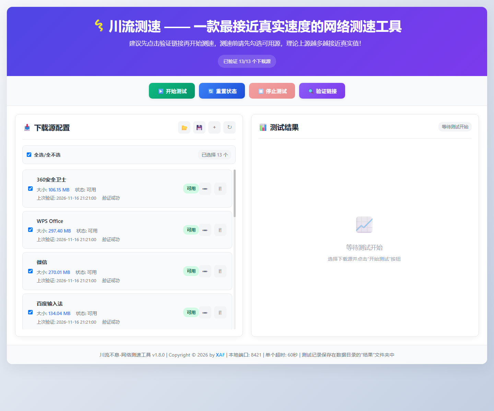

# chuanliuspeed

A local network speed-test tool. It downloads real files from public CDNs, records the
actual bytes and elapsed time, and reports download throughput. The result is the real
download speed from your machine to those sources, not your ISP's advertised bandwidth.



## Features

- Real-file download measurement, reported in Mbps and MB/s.
- Sequential source testing so sources do not compete for bandwidth.
- Live per-source progress, elapsed time, current speed, and overall progress.
- Automatic averaging: with **4 or more valid sources**, the highest and lowest values
  are dropped before averaging; with fewer sources, all values are used.
- Source management: add, edit, delete, enable/disable, import/export, and validation.
- Text result files, rotating run log and action log.
- Fully local frontend assets (no CDN); binds to `127.0.0.1` by default.

## Requirements

- Python 3.10+ (developed and tested with 3.12)
- Windows, macOS, or Linux
- Flask, requests, waitress (see [requirements.txt](requirements.txt))

## Install and run

```bash
python -m venv .venv
# Windows
.venv\Scripts\activate
# macOS / Linux
source .venv/bin/activate

pip install -r requirements.txt
python main.py
```

The browser opens `http://127.0.0.1:8400` automatically.

```bash
python main.py --port 8888        # different port
python main.py --no-browser       # do not open a browser
python main.py --data-dir ./data  # portable data directory
python main.py --host 0.0.0.0     # expose to LAN (not recommended; see Security)
python main.py --version
```

Environment variables: `CHUANLIU_HOST`, `CHUANLIU_PORT`, `CHUANLIU_DATA_DIR`.

## Data directory

Runtime data is written to the current user's data directory, never to the program folder:

| OS | Default path |
| --- | --- |
| Windows | `%LOCALAPPDATA%\ChuanliuSpeed` |
| macOS | `~/Library/Application Support/ChuanliuSpeed` |
| Linux | `~/.local/share/ChuanliuSpeed` |

```text
ChuanliuSpeed/
├── download_url.json     # source configuration
├── config_state.json     # configuration schema version (one-time source merge on upgrade)
├── 临时下载/             # temporary downloads (cleaned automatically)
├── 结果/                 # <test_id>_测试结果.txt
├── 日志/                 # 测速工具.log + 用户操作.log (rotating)
└── app.lock              # single-instance lock
```

Result files and old logs are kept for 90 days. Legacy configuration files
(`source/download_url.json` or `download_url.json` next to the executable) are migrated
automatically on first start. When `config_state.json` is absent, newly added built-in
sources are merged once; custom sources are preserved and later deletions are not undone.

## Measurement details

1. Each selected source is downloaded with a streaming `GET` into a temporary file.
2. Each source is measured for at most **8 seconds** (or 256 MB written). If the file
   finishes sooner, the complete file is used; otherwise the 8-second sample is used.
   Total timeout is 60 seconds per source; socket read timeout is 15 seconds.
3. A source counts as successful only if:
   - the HTTP status is 200/206;
   - the response is not `text/*` or HTML;
   - at least 128 KB was written;
   - for a complete file, the body matches the declared `Content-Length` when present.
     A sampled result intentionally does not require the whole file.
4. Speed = bytes written / elapsed time (including connection setup).
5. Average: failed sources are excluded. With 4+ valid sources, one highest and one
   lowest value are dropped; with 2-3 sources no trimming is applied.
6. Units: Mbps uses 10^6 bit/s; MB/s uses 1024 × 1024 B/s. Therefore
   1 MB/s ≈ 8.39 Mbps.

> Sampling keeps a 13-source run at roughly 2 minutes and limits traffic to about
> "bandwidth × 8 seconds × source count" instead of downloading several GB.

> This is a single-connection, sequential measurement. CDN routing, TCP slow start,
> local disk speed, and proxies all affect the result. For maximum-line-rate testing,
> pick several geographically different sources and repeat the test.

## Configuration

`download_url.json` maps source IDs to source objects:

```json
{
  "wechat": {
    "name": "微信",
    "url": "https://dldir1v6.qq.com/weixin/Windows/WeChatSetup.exe",
    "size": "待验证",
    "enabled": true,
    "valid": false,
    "last_validation": "",
    "last_status": "待验证"
  }
}
```

The default configuration contains **13 official Windows installers** from WPS, 360,
Tencent (WeChat, Tencent Meeting, Tencent Video, QQ Browser), Baidu Input, NetEase Cloud
Music, Thunder, iQIYI, Youku, Sogou Input, and Bilibili. Each source is sampled for at most
8 seconds (or 256 MB), so a full run takes about 2 minutes and does not download the
entire installers. Uncheck sources you do not need on slow connections.

Official installer URLs change with vendor releases. If one becomes unavailable, the
validation marks it invalid; edit it with the current official URL without affecting
the other sources.

- IDs may contain letters, digits, `_`, and `-`; imported IDs are normalized to prevent
  HTML attribute injection.
- URLs must be public `http/https` and may not contain credentials.
- To allow private/LAN URLs (e.g. a NAS), set `CHUANLIU_ALLOW_PRIVATE_URLS=1`.
- Import fully replaces the source list; the UI asks for confirmation and the backend
  re-validates every entry.

## Security model

This is a single-user local application:

- Binds to `127.0.0.1` by default; other machines cannot connect.
- Every POST requires `X-Requested-With: XMLHttpRequest` and a matching `Origin`,
  which blocks cross-site form CSRF.
- All server-provided strings are escaped before entering the DOM; there are no inline
  scripts or styles, and a strict CSP is sent with every response.
- Source URLs are protocol-checked and private/loopback/link-local addresses are
  rejected by default (SSRF mitigation).
- Configuration is written atomically (temporary file + `os.replace`).

> If you expose the tool via `--host 0.0.0.0`, add authentication at a reverse proxy.
> Anyone who can reach the port can manage sources and start/stop tests.

## Project layout

```text
chuanliuspeed/
├── main.py                   # Flask app, measurement engine, config, logging
├── templates/index.html      # page skeleton (Jinja2)
├── static/app.css            # styles
├── static/app.js             # frontend state machine and rendering
├── static/chart.js           # local Chart.js 4.5.1
├── static/chuanliu.ico
├── static/chuanliu.png
├── tests/test_main.py        # pytest unit and API tests
├── docs/screenshot-*.png
├── requirements.txt
├── requirements-dev.txt
├── pytest.ini
├── 网络测速工具.spec          # PyInstaller spec
├── README.md                 # Chinese documentation
└── LICENSE                   # AGPL-3.0
```

## API

All `/api/*` write requests require the `X-Requested-With: XMLHttpRequest` header and a
JSON body.

| Method | Path | Description |
| --- | --- | --- |
| GET | `/` | Main page |
| GET | `/api/config` | Sources, validation state, version |
| POST | `/api/config/update` | `add` / `update` / `delete` / `toggle` / `toggle_all` |
| POST | `/api/config/import` | Replace all sources from a JSON object |
| POST | `/api/validate` | Validate all or selected sources |
| POST | `/api/test` | Start a test: `{"sources": ["id1", "id2"]}` |
| POST | `/api/stop` | Stop the current test |
| POST | `/api/reset` | Stop and reset all test state |
| GET | `/api/status` | Current status, results, average, stats |

## Tests

```bash
pip install -r requirements-dev.txt
pytest
```

The suite covers formatting, averaging/trimming, URL validation, source-ID normalization,
page rendering (no inline scripts/styles, CSP), CSRF, source CRUD, private-URL rejection,
import normalization, real local HTTP download measurement (success, HTML error page,
incomplete body, stop), and atomic configuration writes.

## Packaging

```bash
pip install pyinstaller
pyinstaller --clean --noconfirm 网络测速工具.spec
```

The output is `dist/网络测速工具.exe` (one file, no console). On first run it creates its
configuration in the user data directory, so the executable may live in `Program Files`
or another read-only location.

## Troubleshooting

| Symptom | Fix |
| --- | --- |
| Double-clicking the exe does nothing | Check `日志/测速工具.log` in the data directory; windowed mode has no console |
| Browser cannot connect | Check `netstat -ano | findstr 8400`, or start with another `--port` |
| Port already in use | Another instance is running, or choose a different port |
| All sources unavailable | Check network/proxy; links may have expired; edit or re-import |
| A source times out | 60 s per-source limit; try a different source |
| Config is corrupt | The app renames it to `download_url.json.corrupt-*` and falls back to defaults |
| Full reset | Close the app and delete `download_url.json` in the data directory |

## Changelog

See the Chinese [README.md](README.md#版本历史). v1.8.0 ships 13 built-in official
Windows installers from major Chinese vendors (WPS, 360, WeChat, Baidu Input, Tencent
Meeting, Tencent Video, QQ Browser, NetEase Cloud Music, Thunder, iQIYI, Youku,
Sogou Input, Bilibili). v1.7.0 fixed packaging, windowed-mode
startup, XSS/CSRF/SSRF exposure, threading races, atomic config writes, stop/reset
behavior, validation refresh, progress-bar visibility, average-speed inconsistency,
polling leaks, selection loss, measurement validity, and documentation drift.

## License

[GNU Affero General Public License v3.0](LICENSE) (AGPL-3.0). Commercial use is permitted
under the terms of the AGPL; the previous README's "no commercial use" note was
incompatible with the license and has been removed.
