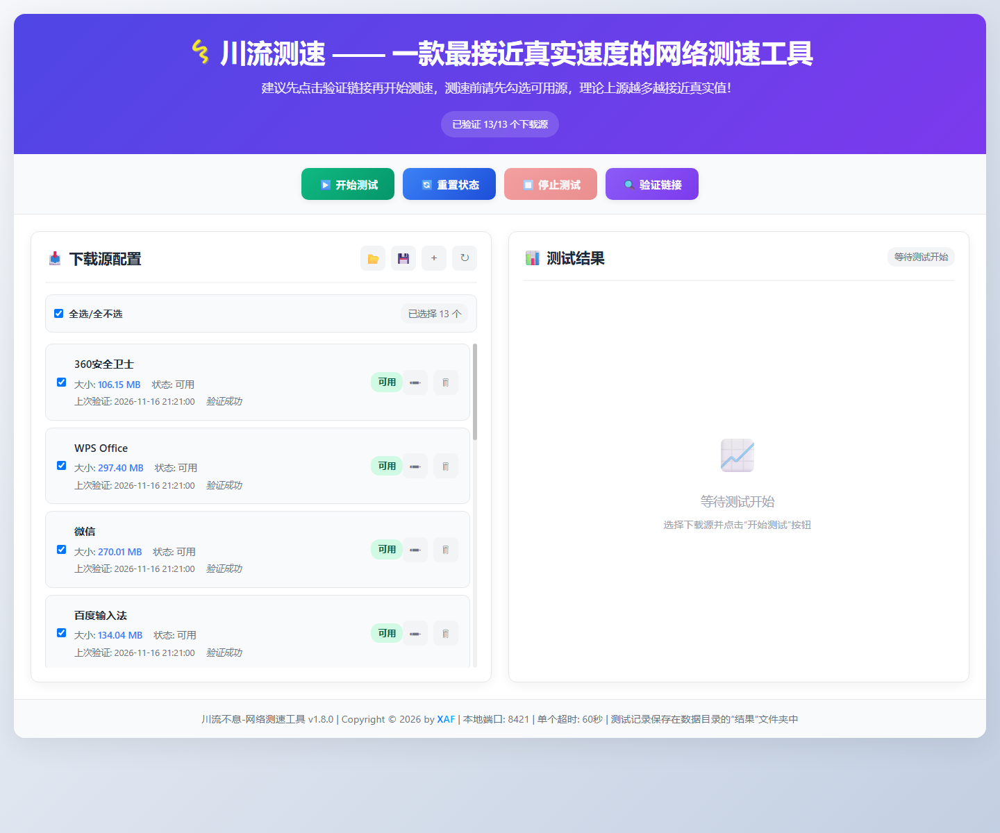

# 川流测速（chuanliuspeed）

一款本地部署的网络测速工具：直接下载网络中真实的文件资源，记录实际字节数与耗时，
计算下载速度，并按规则去掉极值后给出平均值。它测量的是“这台机器到这些 CDN 的真实下载
速度”，而不是运营商宣传带宽。



## 功能

- 基于真实文件下载测速，结果单位为 Mbps 与 MB/s。
- 顺序测试多个下载源，避免多个源同时抢占带宽造成相互干扰。
- 实时显示单个源的进度、已耗时、实时速度，以及总体进度。
- 自动统计有效源，**有效源 ≥ 4 个时去掉一个最高值和一个最低值**再取平均。
- 下载源可增删改、启停、导入/导出，并自动验证可用性与文件大小。
- 测试结果保存为文本文件；操作日志与运行日志自动轮转。
- 前端纯本地资源，不依赖 CDN；默认只监听 `127.0.0.1`。

## 环境要求

- Python 3.10+（开发与测试使用 3.12）。
- Windows / macOS / Linux。
- 依赖：Flask、requests、waitress（见 [requirements.txt](requirements.txt)）。

## 安装与运行

```bash
python -m venv .venv

# Windows
.venv\Scripts\activate
# macOS / Linux
source .venv/bin/activate

pip install -r requirements.txt
python main.py
```

启动后自动打开 `http://127.0.0.1:8400`。常用参数：

```bash
python main.py --port 8888          # 换端口
python main.py --no-browser         # 不自动打开浏览器
python main.py --data-dir ./data    # 指定数据目录（便携模式）
python main.py --host 0.0.0.0       # 供局域网访问（不推荐，见“安全模型”）
python main.py --version
```

也可以使用环境变量：`CHUANLIU_HOST`、`CHUANLIU_PORT`、`CHUANLIU_DATA_DIR`。

## 数据目录

运行时产生的配置、临时文件、结果和日志**不再写入程序目录**，而是写入当前用户的数据目录：

| 系统 | 默认目录 |
| --- | --- |
| Windows | `%LOCALAPPDATA%\ChuanliuSpeed` |
| macOS | `~/Library/Application Support/ChuanliuSpeed` |
| Linux | `~/.local/share/ChuanliuSpeed` |

目录结构：

```text
ChuanliuSpeed/
├── download_url.json     # 下载源配置（自动生成）
├── config_state.json     # 配置结构版本（用于升级时补齐内置源）
├── 临时下载/             # 测速过程中的临时文件（结束后自动清理）
├── 结果/                 # 每次测试的 *_测试结果.txt
├── 日志/
│   ├── 测速工具.log      # 运行日志，10 MB × 10 轮转
│   └── 用户操作.log      # 操作日志，5 MB × 5 轮转
└── app.lock              # 单实例锁
```

- 结果文件保留 90 天，旧日志保留 90 天，启动时自动清理。
- 从旧版本升级时，会自动尝试迁移旧的 `source/download_url.json` 或根目录
  `download_url.json`；`config_state.json` 不存在时会**一次性补齐新增的内置源**，
  不删除、不覆盖用户自定义源。之后用户删除的源不会被再次加回。
- 设置 `CHUANLIU_DATA_DIR` 或在命令行使用 `--data-dir` 可以切换目录。

## 测速原理与口径

1. 对每个被选中的源发起一次 `GET`，以流式方式写入临时文件。
2. 下载过程中每秒计算一次实时速度，前端每 500 ms 拉取一次状态。
3. 每个源**最多采样 8 秒**：达到 8 秒或写入 256 MB 即停止并结算速度；若文件在 8 秒内
   下载完则使用完整文件。单源总超时 60 秒，socket 读超时 15 秒。
4. 只有同时满足以下条件才算“成功”：
   - HTTP 状态码为 200/206；
   - 响应头不是 `text/*` 或 HTML（防止把错误页当成文件）；
   - 实际写入 ≥ 128 KB；
   - 如果是 8 秒内自然下载完的完整文件，声明了 `Content-Length` 时写入量必须达到声明值；
     8 秒采样的结果不要求下完整个文件。
5. 成功源的速度 = 实际写入字节数 ÷ 实际耗时。
6. 平均速度：失败源不计入；有效源 ≥ 4 个时排序后去掉一个最高值和一个最低值，
   其余取平均；不足 4 个时不去极值（避免 3 个源只剩中位数）。
7. 单位约定：
   - `Mbps` 使用 10^6 bit/s；
   - `MB/s` 使用 1024 × 1024 B/s；
   - 因此 1 MB/s ≈ 8.39 Mbps，**并非严格的 8 倍**。

> 8 秒采样让 13 个大安装包源的整轮测试保持在约 2 分钟，流量约为
> “带宽 × 8 秒 × 源数”，而不是完整下载数 GB 文件。测速结果仍是真实下载速度。

> 这是单连接、单源顺序下载测量，受 CDN 调度、TCP 慢启动、本机磁盘和代理影响。
> 若需要测“线路最大带宽”，请选择多个地理位置不同的源并多测几次。

## 下载源配置

配置文件是 `download_url.json`，格式为“源 ID → 源信息”：

```json
{
  "wechat": {
    "name": "微信",
    "url": "https://dldir1v6.qq.com/weixin/Windows/WeChatSetup.exe",
    "size": "待验证",
    "enabled": true,
    "valid": false,
    "last_validation": "",
    "last_status": "待验证"
  }
}
```

### 内置下载源（13 个）

首次运行会自动创建以下官方源，全部为 Windows 安装包：

| 名称 | 厂商 | 约大小 |
| --- | --- | --- |
| WPS Office | 金山办公 | 297 MB |
| 360安全卫士 | 360 | 106 MB |
| 微信 | 腾讯 | 270 MB |
| 百度输入法 | 百度 | 134 MB |
| 腾讯会议 | 腾讯 | 290 MB |
| 腾讯视频 | 腾讯 | 105 MB |
| QQ浏览器 | 腾讯 | 97 MB |
| 网易云音乐 | 网易 | 159 MB |
| 迅雷 | 迅雷 | 198 MB |
| 爱奇艺 | 爱奇艺 | 86 MB |
| 优酷 | 阿里巴巴 | 247 MB |
| 搜狗输入法 | 腾讯/搜狗 | 210 MB |
| 哔哩哔哩 | 哔哩哔哩 | 200 MB |

> 每个源只采样前 8 秒（或完整小文件），13 个源全选时整轮测试约 2 分钟；流量取决于带宽，
> 例如 100 Mbps 下约 1.3 GB。慢速网络建议只勾选 3–5 个源；取消勾选不会被自动重新选中。
>
> 官方安装包 URL 会随厂商版本更新。若某个源以后失效，点击“验证链接”会将其标为不可用，
> 编辑替换成新版本链接即可，不影响其他源。

### 配置字段

- `id` 只允许字母、数字、`_`、`-`，导入时会自动规范化，避免注入 HTML 属性。
- `url` 只接受公网 `http/https` 地址，且拒绝带用户名密码的 URL。
- 如果确实需要测试内网地址（例如 NAS），设置环境变量
  `CHUANLIU_ALLOW_PRIVATE_URLS=1` 后再添加。
- 导入是**完全覆盖**：前端会二次确认，后端会重新校验每条数据并重置验证状态。
- 导出默认导出已勾选的源；未勾选时导出全部。

## 安全模型

本工具默认按“单机本地应用”设计：

- 默认只监听 `127.0.0.1`，局域网其他机器无法访问。
- 所有写操作（POST）都要求 `X-Requested-With: XMLHttpRequest`，并校验 `Origin`，
  阻止跨站表单 CSRF。
- 前端所有服务端字符串都经过转义后再写入 DOM；模板不再包含内联脚本或内联样式，
  并启用 CSP（`script-src 'self'`、`frame-ancestors 'none'` 等）。
- 下载源 URL 做协议白名单，并默认拒绝回环/内网/链路本地地址，避免被当作 SSRF 跳板。
- 配置写入使用临时文件 + `os.replace` 原子替换，避免并发写坏 JSON。

> 如果使用 `--host 0.0.0.0` 暴露到局域网，请自行增加反向代理/鉴权，并意识到
> “任何能访问该端口的人都可以增删下载源、开始或停止测速”。

## 项目结构

```text
chuanliuspeed/
├── main.py                   # 后端：Flask 应用、测速引擎、配置与日志
├── templates/
│   └── index.html            # 页面骨架（Jinja2）
├── static/
│   ├── app.css               # 样式
│   ├── app.js                # 前端状态机与渲染
│   ├── chart.js              # 本地 Chart.js 4.5.1（无 CDN 依赖）
│   ├── chuanliu.ico
│   └── chuanliu.png
├── tests/
│   └── test_main.py          # pytest 单元测试与接口测试
├── docs/
│   ├── screenshot-main.png
│   └── screenshot-results.png
├── requirements.txt
├── requirements-dev.txt
├── pytest.ini
├── 网络测速工具.spec          # PyInstaller 打包配置
├── README.md
├── README.en.md
└── LICENSE
```

## API

所有 `/api/*` 写接口都需要请求头 `X-Requested-With: XMLHttpRequest`，请求体为 JSON。

| 方法 | 路径 | 说明 |
| --- | --- | --- |
| GET | `/` | 主页面 |
| GET | `/api/config` | 下载源、验证状态、版本 |
| POST | `/api/config/update` | `add` / `update` / `delete` / `toggle` / `toggle_all` |
| POST | `/api/config/import` | 批量覆盖导入下载源 |
| POST | `/api/validate` | 验证全部或指定源 |
| POST | `/api/test` | 开始测试，body：`{"sources": ["id1", "id2"]}` |
| POST | `/api/stop` | 停止当前测试 |
| POST | `/api/reset` | 停止并重置所有测试状态 |
| GET | `/api/status` | 当前测试状态、结果、平均速度和统计 |

## 测试

```bash
pip install -r requirements-dev.txt
pytest
```

测试覆盖：

- 文件大小格式化、平均值/去极值规则、URL 校验、源 ID 规范化；
- 页面渲染（无内联脚本/样式、CSP）、静态资源；
- CSRF 防护、配置增删改、私网 URL 拒绝、导入规范化；
- 真实本地 HTTP 服务的下载测量：成功、HTML 错误页、下载不完整、停止；
- 配置原子写入与重新加载。

## 打包

```bash
pip install pyinstaller
pyinstaller --clean --noconfirm 网络测速工具.spec
```

产物为 `dist/网络测速工具.exe`（单文件、无控制台）。首次运行会在用户数据目录创建配置，
不会写入 exe 所在目录；因此可以放在 `Program Files` 或其他只读位置。

## 故障排除

| 现象 | 处理 |
| --- | --- |
| 双击 exe 没反应 | 查看数据目录下 `日志/测速工具.log`；窗口模式没有控制台输出 |
| 浏览器打不开页面 | 确认端口未被占用：`netstat -ano | findstr 8400`，或改用 `--port` |
| 提示端口被占用 | 另一个实例已运行，或换一个端口 |
| 所有源都“不可用” | 检查网络/代理；源链接可能已过期，编辑或重新导入 |
| 某个源测速超时 | 单源超时 60 秒；CDN 限速或链接失效，换源后重试 |
| 配置损坏 | 程序会把损坏文件重命名为 `download_url.json.corrupt-*` 并回退默认源 |
| 想彻底重置 | 关闭程序后删除数据目录中的 `download_url.json` |

## 版本历史

### v1.8.0

- 内置下载源扩充到 **13 个国内大厂官方安装包**（WPS、360、微信、百度输入法、腾讯会议、腾讯视频、
  QQ 浏览器、网易云音乐、迅雷、爱奇艺、优酷、搜狗输入法、哔哩哔哩），全部为 Windows
  安装包，并已逐一验证可用。
- 默认源全部使用官方 CDN；每个源最多采样 8 秒，避免一次测试下载数 GB 文件。
- 旧版本升级时通过 `config_state.json` 一次性补齐 13 个内置源，保留自定义源和用户删除记录。
- 移除原先混合 macOS/Linux 安装包和境外测速文件的默认源，避免平台不匹配和链接过期。

### v1.7.0

- 修复打包配置指向不存在的 `app.py`：spec 改为 `main.py`，并补齐依赖文件。
- 修复窗口模式下 `print`/`StreamHandler` 在 `sys.stdout is None` 时崩溃的问题。
- 数据目录迁移到用户可写目录，支持 `--data-dir` / `CHUANLIU_DATA_DIR`。
- 修复存储型 XSS：服务端校验源 ID/URL，前端统一转义，移除内联脚本与内联样式并启用 CSP。
- 默认监听 `127.0.0.1`；写接口增加 CSRF 头校验；默认拒绝内网 URL（可显式放开）。
- 为全局状态加锁，状态查询返回快照；配置改为原子写入，避免并发写坏。
- 停止测试会主动关闭连接，不再需要等到 socket 超时；重置会等待测试线程退出。
- 修复启动验证不置状态位导致页面不自动刷新的问题。
- 修复总进度条被隐藏、平均速度在测试中/结束后跳变、前端轮询泄漏、勾选丢失等问题。
- 单源超时统一为 60 秒；增加最小有效字节、Content-Length 完整性、HTML 响应校验和 512 MB 上限。
- 文件大小探测不再整包下载；HTTP 响应统一关闭；禁用压缩传输避免字节数失真。
- 平均值统一由后端计算，前端直接展示；有效源 < 4 个时不再去极值。
- 前端拆分为 `static/app.css` + `static/app.js`，本地 Chart.js，无 CDN 依赖。
- 更新 README/英文 README、依赖清单、`.gitignore` 和 pytest 测试。

## 许可证

本项目使用 [GNU Affero General Public License v3.0](LICENSE)（AGPL-3.0）。
你可以自由使用、修改和分发，但分发修改版本或通过网络提供服务时，需要按 AGPL 的
要求提供对应源代码。README 不再附加“禁止商业使用”的限制——那与 AGPL 不兼容。
